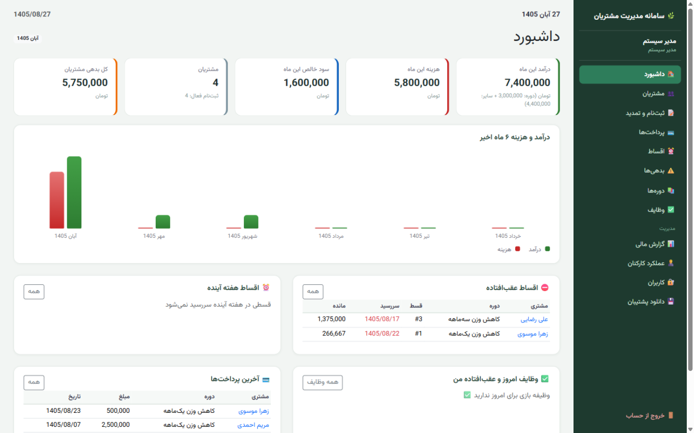
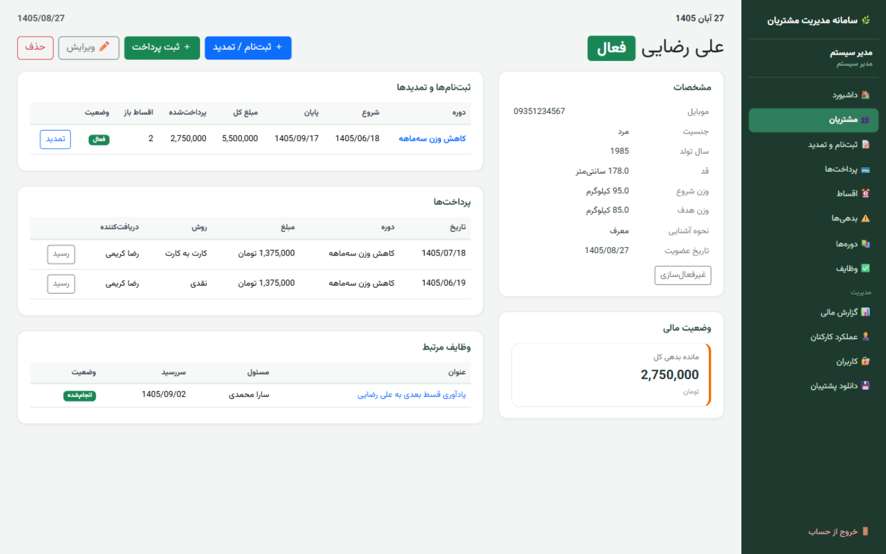
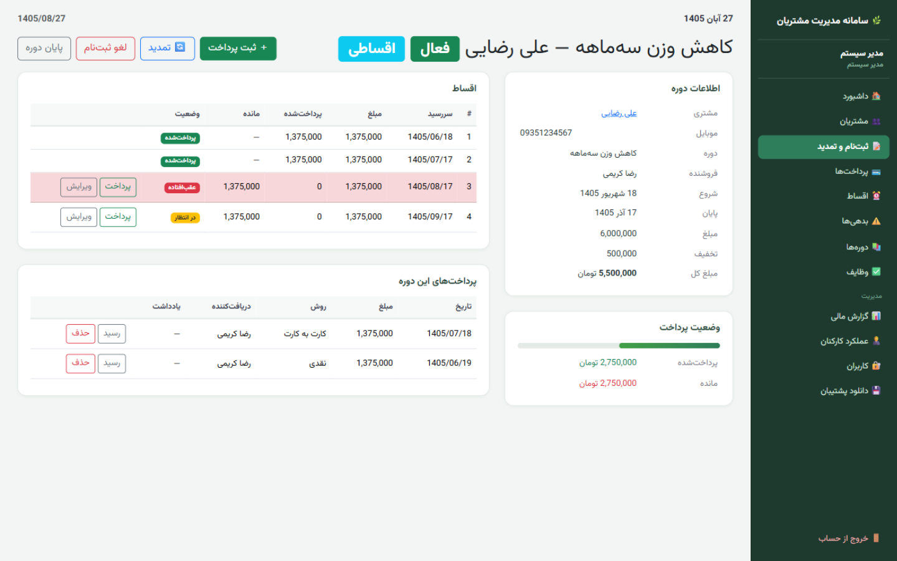
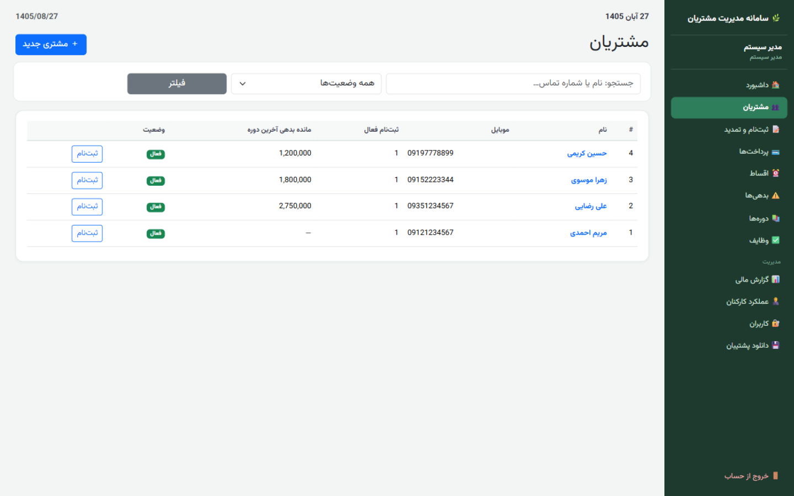
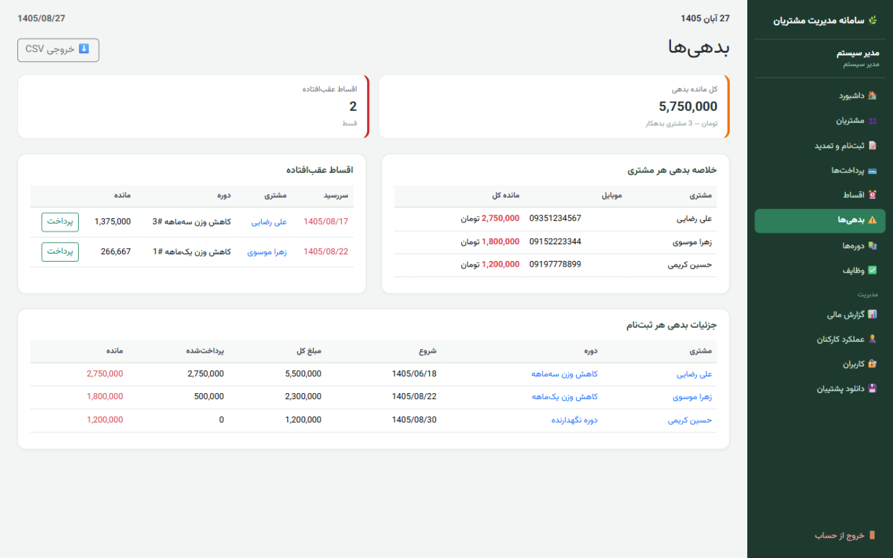
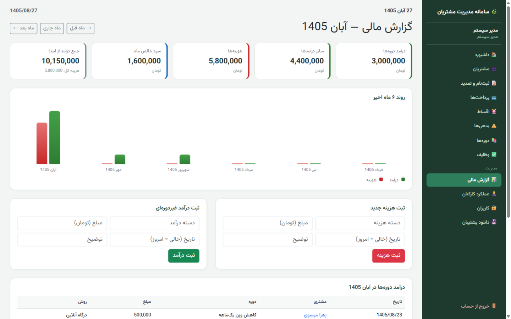
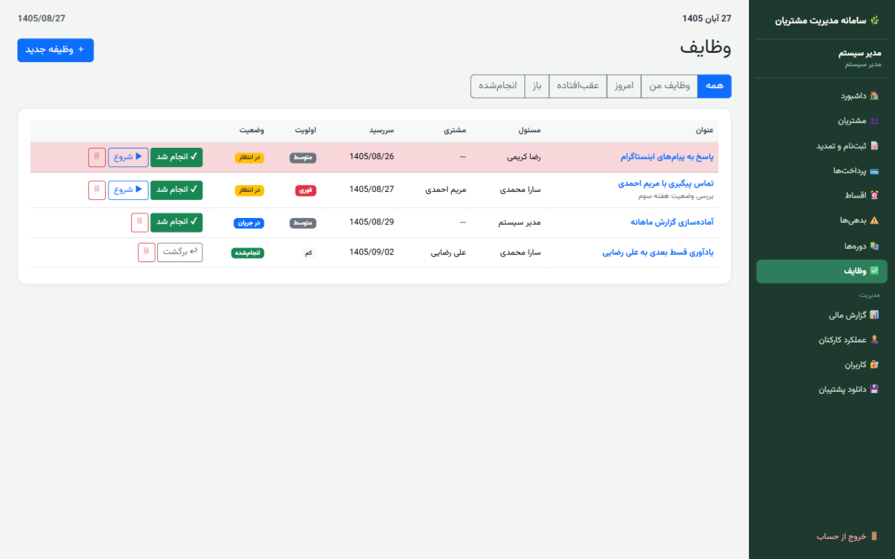
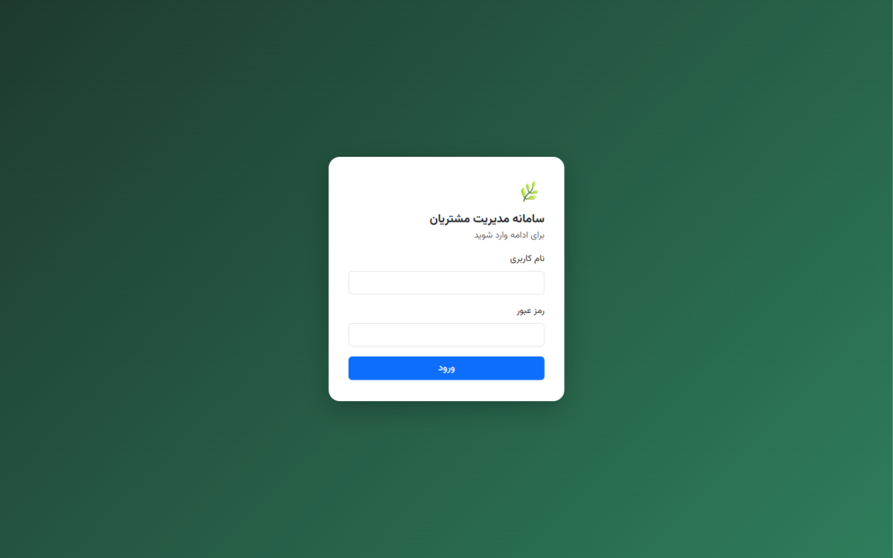

# 🌿 Clinic CRM — سامانه مدیریت یکپارچه مشتریان کلینیک

**English:** A Persian (RTL) web-based CRM built for an online weight-loss clinic — customer profiles, course enrollments & renewals, cash & installment payments, debt tracking, income/expense reporting, staff tasks & performance, and a financial dashboard. Runs fully offline on a small office network for 3–5 concurrent users.

**فارسی:** سامانه مدیریت مشتریان تحت وب برای کلینیک مشاوره آنلاین کاهش وزن — پرونده مشتریان، ثبت‌نام و تمدید دوره‌ها، پرداخت نقدی و اقساطی، محاسبه بدهی‌ها، گزارش درآمد و هزینه، مدیریت وظایف و عملکرد کارکنان، و داشبورد مالی. کاملاً آفلاین روی شبکه دفتر، برای ۳ تا ۵ کاربر هم‌زمان.


---

## ✨ Features | امکانات

| | Feature (EN) | امکانات (فارسی) |
|---|---|---|
| 👥 | Customer profiles with measurements, search & history | پرونده کامل مشتری با قد/وزن/هدف و سابقه کامل |
| 📝 | Course enrollments & renewals (linked to previous course) | ثبت‌نام و تمدید دوره با اتصال به سابقه قبلی |
| 💳 | Cash & installment payments with printable receipts | پرداخت نقدی/اقساطی با رسید چاپی |
| ⏰ | Auto-generated installment schedules, partial payments | تقسیم خودکار مبلغ به اقساط و پرداخت جزئی |
| ⚠️ | Debt tracking per customer, overdue alerts, CSV export | بدهی هر مشتری، اقساط عقب‌افتاده، خروجی CSV |
| 📊 | Monthly income/expense report + 6-month chart | گزارش مالی ماهانه + نمودار ۶ ماهه |
| ✅ | Staff task management with due dates & priorities | مدیریت وظایف کارکنان با سررسید و اولویت |
| 🧑‍💼 | Staff performance (sales, collections, tasks) | عملکرد هر کارمند: فروش، دریافتی‌ها، وظایف |
| 🔐 | Role-based access (admin / staff) | دسترسی مدیر و کارمند |
| 💾 | One-click database backup | پشتیبان‌گیری با یک کلیک |
| 📅 | Full Jalali (Persian) calendar support — zero dependencies | تقویم شمسی کامل بدون وابستگی خارجی |
| 🌐 | 100% offline (Bootstrap + Vazirmatn font bundled) | کاملاً آفلاین — فونت و استایل داخل پروژه |

## 📸 Screenshots | تصاویر

### Dashboard | داشبورد


### Customer Profile | پرونده مشتری


### Enrollment & Installments | ثبت‌نام و اقساط


### Customers List | لیست مشتریان


### Debts | بدهی‌ها


### Finance Report | گزارش مالی


### Tasks | وظایف


### Login | صفحه ورود


## 🧱 Tech Stack | تکنولوژی‌ها

- **Backend:** Python 3 + Flask
- **Database:** SQLite (WAL mode, zero-config, file-based backup)
- **Frontend:** Jinja2 templates + Bootstrap 5 RTL
- **Font:** Vazirmatn (bundled — works offline)
- **Calendar:** Custom Jalali ⇄ Gregorian converter (`examples/jalali_date.py`) — validated against 5,000 random dates against a reference library
- **Auth:** Session-based login with role-based access control

## 🔒 About the Source Code | درباره کد منبع

> **EN:** This repository is a **portfolio showcase only**. The complete runnable source code is intentionally **not** included — it is proprietary work delivered to a client. `examples/jalali_date.py` is the only shared code (a standalone, dependency-free Jalali ⇄ Gregorian date converter). Serious inquiries via email below.
>
> **فارسی:** این مخزن فقط برای **نمونه‌کار** است. کد کامل و قابل‌اجرا عمداً در آن قرار نگرفته — این محصول اختصاصی و تحویل‌شده به کارفرماست. تنها فایل به‌اشتراک‌گذاری‌شده `examples/jalali_date.py` است (تبدیل تاریخ شمسی/میلادی بدون وابستگی). برای همکاری از راه ارتباطی پایین استفاده کنید.

**Architecture at a glance:**
```
crm-system/
├── app.py            # All routes, role guards, dashboard & report logic
├── db.py             # SQLite schema, WAL config, demo seeder
├── jalali.py         # Jalali ⇄ Gregorian conversion (no external lib)
├── run.bat           # Double-click launcher for Windows
├── templates/        # 22+ Persian RTL pages
├── static/           # Bundled Bootstrap RTL + Vazirmatn fonts
└── data/             # Auto-created SQLite database (never in git)
```

## 💼 Contact | ارتباط

For the full system, custom development, or similar projects:
برای دریافت نسخه کامل، سفارشی‌سازی یا پروژه‌های مشابه:

**Shima Mohammadi** — shima.m9675@gmail.com

---

### 🔍 Keywords
`CRM` `Flask` `Python` `SQLite` `Persian` `Farsi` `Jalali Calendar` `تقویم شمسی` `سامانه مدیریت مشتریان` `نرم‌افزار کلینیک` `Bootstrap RTL` `وب اپلیکیشن فارسی` `مدیریت مالی` `اقساط`
